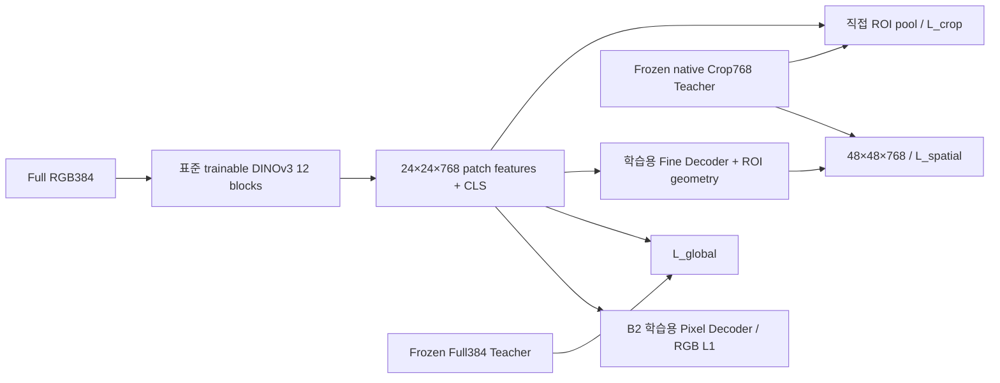

# DINOv3 Training-only Fine-grained Supervision Pilot (Seed 0)

표준 DINOv3-B/16 자체의 지역 속성 표현을 평가한다. Fine/Pixel Decoder는 학습 시에만 존재한다. 모든 B 조건은 같은 Original pretrained `vit_base_patch16_dinov3.lvd1689m`에서 독립적으로 시작한다. G1-pool, G1-cross 또는 A0에서 초기화하지 않는다.

## 구조와 손실

Student 입력은 Full RGB384 letterbox, Patch16, 12개 원래 Transformer Block, 최종 24×24×768 patch feature다. 표준 timm DINOv3의 `forward_features`를 그대로 호출한다. Encoder Forward는 ROI와 독립적이다. Fine→Coarse feedback, RGB 입력 Fine branch, 추론용 Adapter/Projection/Calibration은 없다.

Native Teacher는 원본 RGB에서 먼저 ROI를 crop하고 기존 Crop Oracle의 aspect-preserving Bicubic letterbox로 RGB768을 만든 Original frozen DINOv3다. 출력은 48×48×768이다. 768 resize가 원본에 없는 새 픽셀 정보를 생성하는 것은 아니며, Encoder를 더 세밀한 공간 단위에서 계산한다. 셀과 letterbox content의 교차 면적 비율 c_q로 mask/weight한다. 완전 padding 셀은 제거한다. 부분 content 셀은 기존 coverage 규칙으로 가중한다. 압축 캐시는 **유효 원래 token을 그대로** float16 저장하며 48×48 좌표를 보존한다. 기존 E1b의 최대 12×12 재집계 target은 사용하지 않는다. Pooled 및 Full384 global target은 동일 체크포인트와 ROI의 기존 캐시를 실제 재인코딩으로 검증 후 재사용한다.

Fine Decoder는 G1의 Fourier ROI-relative/absolute 좌표 처리 및 XBlock을 재사용한다. Coarse token 768→256 학습용 입력층, 48×48 위치별 query, 2 cross-attention/FFN blocks (8 heads, MLP ratio4), 출력 256→768이다. 모든 Decoder 입력은 Coarse Feature, ROI geometry, Full-image valid-key mask다. RGB를 받지 않는다. Encoder Feature는 detach하지 않고 Teacher는 detach한다.

정의 d(a,b)=1−cos(a,b), weighted_pool(F,w)=ΣwF/Σw:

- L_crop = mean_ROI d(weighted_pool(Student(full384), ROI∩patch area), pooled Native Crop768 Teacher). Encoder 최종 feature에 직접 적용한다.
- L_spatial = mean_ROI Σ_q c_q d(Decoder(F, ROI)_q, Teacher_q)/Σ_q c_q. 같은 teacher token index에 대응하는 ROI-relative query를 쓴다. 별도 relational/pooled decoder loss는 없다.
- L_global = mean_image 0.5[d(CLS_s,CLS_0)+d(valid_patch_mean_s,valid_patch_mean_0)]. Full384 frozen Original teacher의 기존 G1 규칙이다.
- B0: L_crop + 0.5 L_global. B1: B0 + λ_spatial L_spatial.
- B2 (gate 통과 시에만): B1 + 1.0 L_pixel. 학습용 LN→Linear768→GELU→Linear768 head가 각 token에서 RGB16×16을 복원한다. Decoder 입력은 Student feature뿐이며, Student가 실제 관측한 Full384 RGB의 patch-level mean L1을 쓴다. Edge는 진단만 기록한다. Denoising/Flow는 없다.

λ_spatial은 초기 동일 첫 stream mini-batch에서 Encoder 전체 gradient를 각각 구해 `0.5 ||∇E L_crop|| / ||∇E L_spatial||`로 한 번 고정한다. Calibration에서 가중치를 학습하거나 Val/Test를 보지 않는다. 초기 spatial gradient가 비영(非零)이므로 decoder warmup은 사용하지 않는다. 측정 값과 patch embedding/12 block별 norm은 `lambda_spatial.json`에 저장한다.



Spatial/Pixel loss의 backward gradient만 Encoder에 전달된다. Forward에서 Decoder 출력이 Encoder로 되돌아가는 경로는 없다. 추론은 `Full RGB384 → 동일 표준 DINOv3 → 24×24×768`뿐이며 평가용 R2/Linear Probe를 따로 붙인다.

## 데이터와 학습

사용자의 후속 지시에 따라 **기존 GT + Random + fallback ROI를 모두 포함**한다. 기존 COCO train2017 stream 12,000행, 행당 16 images×4 ROI, augmentation 없음, stream 생성 seed2027 및 모델 seed0을 유지한다. 축소 Probe manifest의 기존 제외 함수만으로는 전체 Official Split을 보호하지 못한다. **Official Val2410/Test9443의 모든 image ID(속성 미주석 포함)**, 기존 MD5/pixel-MD5/dHash exact audit, 확인된 Val/Test 근접 중복 train 이미지를 모두 제외한다. 원래 stream50491장에서 총641장을 제외한 **49,850 images/199,400 GT+random+fallback ROI**로 학습한다. 매 step의 원래16개 image slot은 유지하되 제외 slot은 건너뛴다. 같은 규칙을 B0/B1/FrozenDecoder에 적용한다. 첫 batch는15 images/60 ROI다. 검증 결과 train/dev의 Official Val/Test image overlap은 모두0이다. COCO dev는 추가 중복 제외 후126 images/504 ROI이며 모델 선택에 쓰지 않는다. 전체 ID와 검증은 `teacher/manifest.json`, `official_split_exclusion.json`에 기록한다. 원래 G1의 unsupervised COCO 학습에는 full official Val146/Test475 exact 이미지가 포함됐으므로 matched data ablation으로 취급하지 않는다. Test score나 Test method/epoch selection을 사용하지 않는다.

G1의 Encoder AdamW top lr5e-5, layer decay0.75, wd0.05 (1-D/token/pos 제외), betas(0.9,0.999), warmup600+cosine, module별 clip1.0, BF16, EMA0.999→1을 유지한다. Decoder lr3e-4. 원래 64 ROI global step을 GPU1개에서 처리하며 조건별로 GPU를 배정한다. 최대 물리 GPU2개만 사용한다. Encoder 모델 선택은 **12k 최종 EMA**로 사전 고정한다. Student raw도 별도 export한다. 500step마다 optimizer/모델/EMA/RNG recovery를 저장한다.

FrozenDecoder 대조군은 동일 Original Encoder를 고정하고 동일 spatial 가중치·Decoder·12k budget에서 Decoder만 학습한다. 이 Encoder는 원본과 bit-identical임을 state hash로 검증한다. 별도 PACO Probe 재학습은 원본 중복이므로 하지 않는다. 동일 COCO dev ROI에서 B1의 step별 reconstruction과 비교한다. COCO dev126 images는 진단용이며 Encoder/Probe epoch 선택에 사용하지 않는다. ROI별 Full384 patch 면적-equivalent token 수, 교차하는 cell 수, spatial cosine을 함께 저장한다. Tiny ROI에서 48×48 출력이 관측하지 못한 세부를 복원한다고 해석하지 않는다.

## PACO Official Validation

기존 `src.g1up.train_bb`, R2 Reader, `src.pdit.bbdata`의 bilinear ROIAlign24×24, `src.pacoattr.official_eval`을 그대로 사용한다. 새 AP/evaluator를 만들지 않는다. 새 `fgtrain.infer`는 exported 표준 Encoder와 기존 ROI sampling/Reader를 연결해 기존 공식 manifest 형식의 확률을 저장하는 adapter다. 본 모델의 이미지당 Encoder canvas 수가 1인지 실제 계수하며 RGB ROI 재인코딩이 없음을 검증한다. Fine/Pixel/Teacher는 instantiate하지 않는다.

Reader seed0 (기존 init seed7), 10epochs, PACO train 내부 dev1000 이미지 분리, 기존 excluded train split, ~128 ROI packs, hflip0.5, masked BCE, reader lr3e-4/head lr1e-3, AdamW wd0.05, 1epoch warmup+cosine, clip1.0을 유지한다. 전 조건 R2 selection은 **10 epoch 중 Official Val (Object AP+Part AP)/2 최대, 동점이면 앞 epoch**다. 공식 Val2,410 images/31,919 ROI를 사용하며 기존 probe의 축소 Val2,051 images 점수와 혼동하지 않는다. GT Box+Category Oracle, max_dets300, 기존 공식 Attribute AP를 쓴다. Overall은 Object/Part 평균이다. Pattern/Color/Material은 공식 type별 출력만 보고한다. 새 크기별 AP나 custom metric은 만들지 않는다.

Frozen Full384(bilinear R2) 및 Native C0 Crop384는 이미 완료된 동일 10epoch probe/공식 Val 전 epoch 결과를 검증 후 재사용한다. G1-cross Encoder-only는 과거 full-canvas R2와 ROI 처리 방식이 달라 이번에는 같은 bilinear R2를 10epoch 새로 학습한다. G1-cross 가중치는 기존 12k Crop384+Detail+Global final EMA에서 encoder만 추출한다. C0는 표준 Original Encoder이지만 **ROI별 원본 RGB 재인코딩**을 하는 정보 oracle이므로 배포 가능한 B 조건과 추론 비용이 다르다.

B2는 B1−B0의 Overall 및 두 Pattern AP 차이가 양수이고 paired-image bootstrap1000의 95% CI 하한도 모두 양수이며, 고정 ep10의 두 Pattern 차이도 양수일 때만 진행한다. 이는 seed0에 대한 보수적 진행 규칙이며 seed 안정성의 증명은 아니다. Bootstrap CI는 선택된 Reader epoch에 조건부이며 epoch 선택 변동을 포함하지 않는다. Reconstruction loss는 gate로 사용하지 않는다. 모든 선택은 Val이며 개발 중 Test는 사용하지 않는다. 사용자 추가 요청에 따른 최종 Test는 Val-selected Reader epoch와 Encoder hash를 먼저 고정한 후 별도로 보고한다. Test 결과로 선택·가중치·B2 gate를 변경하지 않는다.

## ADE20K 동일 Frozen Linear Probe

공식 ADEChallengeData2016의 train20,210/Val2,000 이미지와 150 classes가 실제 존재함을 확인했다. 기존 **`src.g1eval.ade`를 수정하지 않고** B0/B1 Export loader만 연결한다. Frozen Original 및 G1-pool/G1-cross의 기존 동일 프로토콜 결과는 checksum/설정을 확인해 재사용한다. B0와 B1은 둘 다 평가하고, B2를 실행했다면 함께 평가한다.

Head는 최종 LN patch feature만 읽는 Linear(768,150), BN/fusion/decoder 없음이다. Encoder eval/frozen/no_grad, head만 AdamW lr1e-3, betas(0.9,0.999), weight wd1e-4/bias wd0, 40,000 iterations, global batch16 (2GPU×8), seed0, warmup1500 (ratio1e-6), poly1.0로 학습한다. 동일 sample order, head initialization, worker12, 동일 augmented tensor를 모든 B encoder에 공급한다. 최종 iteration을 평가하며 Val epoch selection은 없다.

기존 표준 프로젝트 전처리를 우선하므로 **train은 384×384, validation은 short-side384를 유지한 가변 크기**다. 모든 입력을 정사각384로 찌그러뜨리는 새 프로토콜은 만들지 않는다. Train: aspect-preserving short-side384×U(0.5,2), random crop384, hflip0.5, ImageNet norm. 작은 이미지는 normalized RGB0/mask255로 padding. Val: short-side384, Patch16 배수 padding, padding crop 제거 후 logits를 원래 GT 좌표로 bilinear resize한다. Val patch grid는 원래 이미지 aspect에 따라 24×N일 수 있으며 이는 기존 baseline에도 동일하다. ADE label0→ignore255, 1..150→0..149, mask nearest resize, ignore/padding 제외, 전체 Val class별 intersection/union으로 mIoU를 계산한다. 기존 256 BRIXEL 실험의 B0/B1과는 다른 실험이다.

## 기존 실험과의 비교 범위

| 실험 | Encoder / 초기화 / Teacher | 이번 실험과 다른 점 |
|---|---|---|
| G1-pool / G1-cross (`src/g1x`) | 표준 DINOv3-B/16, Original init, Crop384,12k (Frozen은0step) | G1 detail은 24×24 및 decoder pooled term; 이번 target은 Native768 48×48, 단순 spatial cosine, λ gradient0.5; 기존 full-grid R2와 새 bilinear R2 구분 |
| A0 / P (`src/hcf`) | DINOv3 + RGB Patch8 Fine path 및 양방향 exchange; G1-pool EMA init, 추가12k (총24k) | Fine path가 추론에 남음. A0 계열은 object4+추가 nested ROI 감독도 사용해 본 G1 image16×ROI4 stream과 차이가 있음 |
| E1a / E1b (`src/overnight6`) | A0 Coarse–Fine, G1-pool 기반 common initial.pt, Native Crop768 pooled/spatial, 추가12k | **E1a를 B0로 재사용하지 않음**. Spatial target은 최대12×12 집계, Fine-grid 비교 및 작은 ROI 제외 |
| D1 / L2 Spatial·Relational (`src/decstudy`) | CLIP-L/14@336, G1-cross 초기화, Crop384(C1 비교 포함) | Backbone·초기화·ROI 및 inference decoder가 다름. 실패를 이번 plain DINOv3의 실패와 등치하지 않음 |
| PixelDiT Pure / Hybrid / P-C768 (`src/pdit`, `src/pc768mse`) | A0 Coarse–Fine, G1-pool 기반 common initial.pt, Flow/Denoising, Crop384 또는768, 추가12k | 학습/추론 backbone과 pixel objective가 다름. 이번 B2는 단순 patch RGB L1, training-only |
| H0/H1 (`src/hier`) | P384 Coarse–Fine + RGB640 Detail branch, H0=Full384→640 / H1=Native640 | 저장소의 H0/H1는 Shared Hierarchical Patch-Pixel 명칭이다. 추가 Detail branch가 추론에도 남아 본 training-only decoder와 다름 |
| MSD H0/H1 (`src/msd`) | Frozen DINOv2-B/14@336 및 decoder, H0=L12 / H1=L12+0.5L8+0.5L4 | 동일 이름의 별도 실험이며 PixelDiT 또는 DINOv3-only가 아님 |
| G1-Native (`src/g1native`) | G1-pool 기반 A0, 원본 Full image→768 Frozen Teacher; Crop384+Grid+Global | 본 실험의 Native ROI→Crop768 Teacher와 crop 범위가 다르며 A0 추론 Fine path가 남음 |
| J-series (`src/jointpg`) | G1-pool 기반 A0 common initial.pt에서 추가12k Crop+Flow+Grid 및 weight mixing | 기존 공식 Val 결과만 문맥으로 기록. 이번 λ 또는 모델 선택에 기존 Test 결과를 사용하지 않음 |

기존 `results/overnight_six/README.md`, `results/pixeldit_crop768_vs_mse/README.md`, `results/joint_pixeldit_g1/eval/results/fast_tables.md`에서 Spatial/Flow의 loss 개선이 Pattern AP 개선을 보장하지 않았음을 확인했다. Backbone 또는 평가가 다른 점수를 B0/B1의 matched ablation으로 취급하지 않는다.

Global cosine 및 L_global은 진단값이다. ADE20K는 공간 표현 보존을 평가하지만 ImageNet 등의 global classification 성능을 직접 대체하지 않으므로, 이 파일럿만으로 모든 Global 성능이 보존됐다고 주장하지 않는다.

## 재현 및 제어

환경: `/home/irteam/envs/dinov2_ord_py310/bin/python`; 공식 PACO evaluator만 기존 `paco_eval` 환경을 쓴다. 코드와 의존 소스 SHA256, 초기화 hash, 캐시 표본·설정·버전은 run 아래에 보존한다.

```bash
# 최초 준비 (기존 allocation은 재색인하지 않음)
python -m src.fgtrain.setup
# 실제 smoke/calibration (기존 background jobs는 checkpoint pause)
python -m src.fgtrain.preflight
# 재시작 가능한 전체 queue; 완료된 단계는 state marker로 건너뛴다.
python -m src.fgtrain.pipeline
# 읽기 전용 결과 표 갱신
python -m src.fgtrain.report
```

Queue는 물리 GPU0/1만 사용한다. 최초 실행의 전체 pause 정책은 아래의 최신 GPU별 병행 정책으로 대체했다. 원래 사용자의 pause는 보존한다. Queue PID는 `pipeline.lock`, GPU/CPU child PID와 명령은 `active.json`에 있다. 중단된 학습은 500step recovery에서 다시 시작한다. Pipeline 자체의 SIGTERM은 자체 child process group만 종료한다.

2026-11-10 사용자 추가 지시: GPU 활용률80% 이상(가능하면100%)을 목표로 기존 A/B 및 대조군/미완료 평가와 파일럿을 동시 실행한다. 전체 PAUSE_all은 해제했고, bgjobs supervisor의 fgtrain_s0 동시 실행 허용과 GPU별 기존 작업 분산을 적용했다. 기존 체크포인트에서 재개하며 학습 설정·예산은 변경하지 않는다. `background_policy.json`, `resource_update.json`, `gpu_rebalance.json`을 참조한다.

최신 GPU 운영 지시(2026-11-10 13:46 UTC): 두 GPU의 활용률80% 이상을 우선하여 ADE20K 평가 중에도 기존 A/B를 병행한다. `src.fgtrain.resources`의 `background_policy.json`이 FrozenDecoder 및 ADE의 병행을 허용한다. 완료된 A/B의 새 초기화 반복도 사용자가 명시적으로 허용하여, 동일 설정·seed0·100k 예산의 A_r3(GPU0), B_r3(GPU1)를 별도 디렉터리에 등록했다. 기존 결과를 보존하며, 활용률을 위한 동일 seed 반복은 독립적인 과학적 근거로 세지 않는다. `gpu_allocation.json`이 실시간 배정의 기준이다. 병행으로 평가 소요 시간은 늘어날 수 있다.

운영 정책 갱신(2026-11-10 14:21 UTC): 사용자가80% 이상을 유지하면 A/B 실행량을 줄여 평가를 가속해도 된다고 허용했다. A/B를22초 일시 정지해 측정한 결과 ADE 학습만으로도 GPU0/1 각각89~100%,90~100%를 유지했다. 따라서 dense ADE 학습 중 A/B는 checkpoint pause하고, 최종 head 저장 이후의 단일 이미지 validation 및 완료 후에 자동으로 재개한다. 실험의 데이터·optimizer·배치·seed·학습 예산은 그대로이며 실행 동시성만 변경했다. 측정 원본은 `background_throughput_measurement.json`, 현재 정책은 `background_policy.json`이다. 앞의 전체 병행 정책을 이 정책이 대체한다.

ADE 실행 오류 및 복구: 첫 torchrun 실행은 `--run` 인자가 launcher의 `--run-path`와 혼동되어 평가 시작 전에 종료됐다. module 앞에 명시적인 `--` 경계를 넣고 실제 launcher parser로 전달 인자를 검증한 후, 완료된 학습/PACO는 재사용하여 ADE만 재개했다. 기록은 `ade_launch_recovery.json`, `launch_failures/`에 보존했다. 이후 실행은 기존 프로젝트의 CUDA JIT cache를 명시적으로 활성화하여 NCCL의 최초 컴파일 지연을 줄인다. 이 수정은 데이터·모델·평가 프로토콜을 변경하지 않는다.
