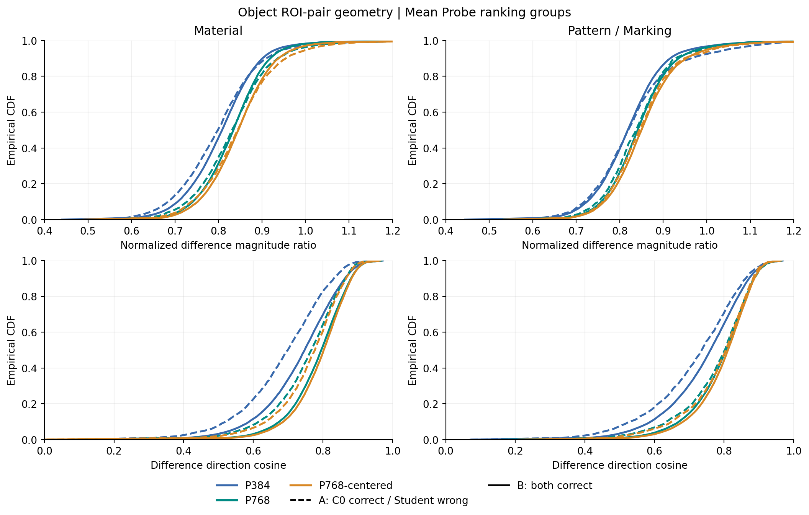
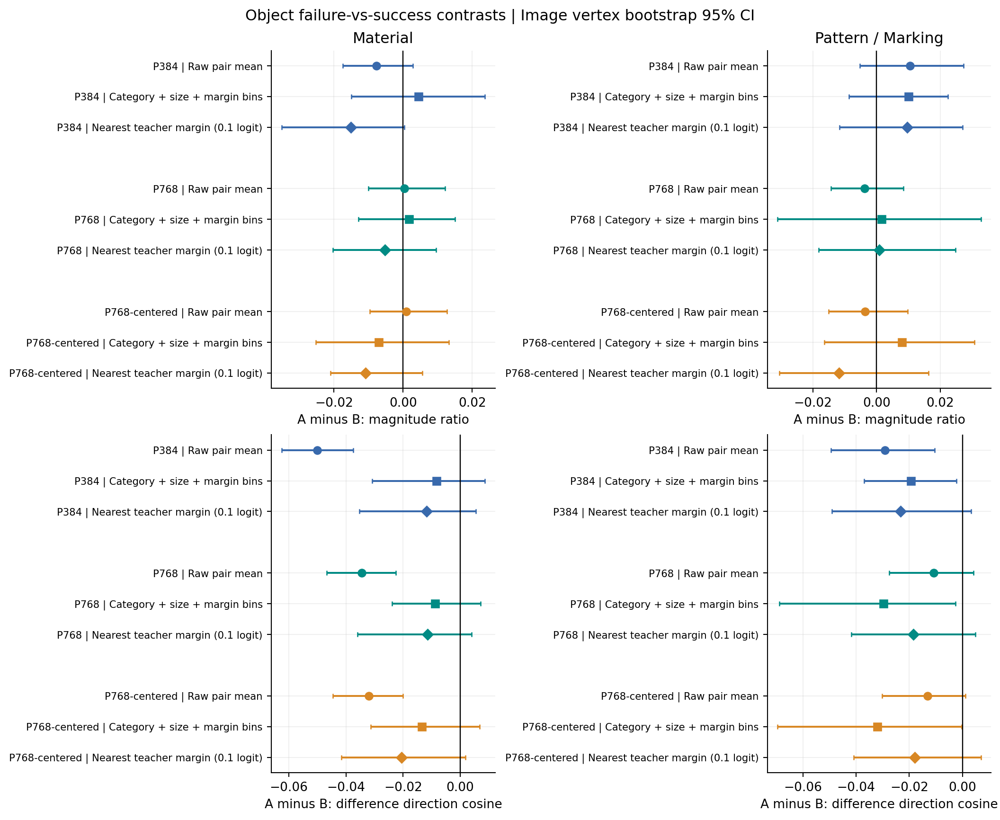
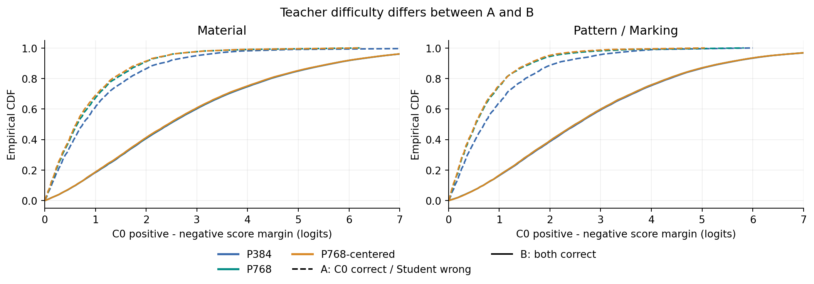
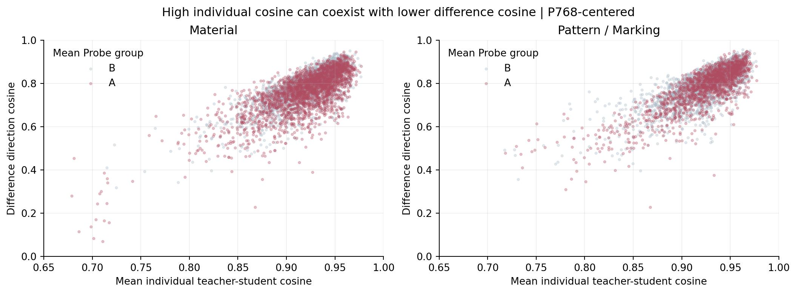
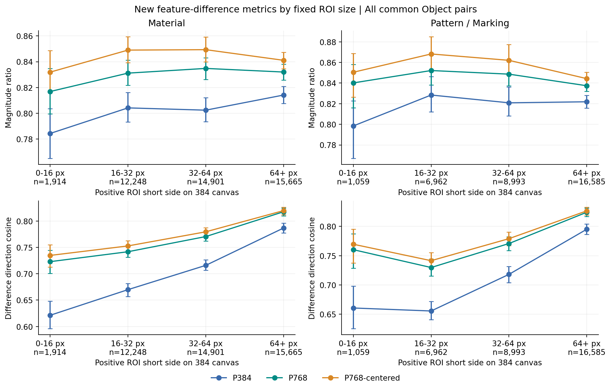

# Crop–Student ROI Pair Feature Difference 진단

작성일: 2026-11-09. Seed 0. **PACO Val / project M2 조건만 사용**했습니다. 새 encoder·decoder·reader·probe 학습은 없습니다.

## 판단

Student의 정규화된 ROI 차이는 Crop보다 작고, 방향도 완전히 일치하지 않습니다. 그러나 **Crop만 맞는 A 그룹에서만 차이가 특별히 소실된다는 근거는 약합니다.** 성공한 B 그룹에도 비슷한 크기 축소가 있습니다. A의 방향 cosine은 단순 비교에서 낮지만, Crop margin까지 가깝게 맞추면 Object Material·Pattern 모두 95% CI가 0을 포함합니다. 이 결과는 오류 원인이 없다는 증명이 아니라, 이번 진단으로 원인을 특정하지 못했다는 뜻입니다.

**Relative Distillation을 새로운 Method로 제안할 실증 근거는 아직 충분하지 않습니다.** 동일 pair에서 768 입력의 기하적 개선은 확인되며, 기존 head를 바꿔 적용하면 일부 실패가 회복됩니다. 따라서 입력 세부 정보와 속성 판별 방향을 분리해서 검증할 근거는 생겼지만, 전체 difference vector를 더 맞추면 AP가 좋아진다는 결론은 나오지 않습니다.

## 1. 기존 분석과 실제 비교 조건

기존 HTML은 `/home/irteam/sg/crop-rep/experiments/hcf/diagnosis.html`입니다. Material-specific diagnostics, matched Mean Probe 보고서, ranking 원본 코드를 확인했습니다. HTML의 기존 pilot P는 `hcf_pilot/P`이고, 이번 P384는 **`hcf_material_causal/r384_cosine/P`**입니다. 두 checkpoint를 혼용하지 않았습니다. P768과 P768-centered도 같은 causal 실험의 12,000-step final EMA입니다. 2시간 PixelDiT 추가 학습 결과는 사용하지 않았습니다.

기존 Material ranking 원본은 **공식 Test**의 `probs_test.npz`로 pair를 생성했고, 결과 JSON에는 pair ID가 아닌 집계만 저장했습니다. 따라서 해당 Test pair를 Val 진단에 재사용할 수 없었습니다. 기존 선택 원리를 Val에 적용해 공통 pair를 새로 만들었으며, 기존 Test prediction·label을 이번 계산에 읽지 않았습니다. 원본 HTML·ranking 코드·집계·Mean Probe 보고서는 `source/`에 별도 보존했습니다.

아래 AP는 **기존 Val curves의 dev-M0-selected epoch 결과를 재사용**한 것입니다. 이번에 AP 분석이나 probe 학습을 반복하지 않았습니다.

| 모델 | Full 입력 | Mean epoch | R2 epoch | Mean Material | Mean Pattern | R2 Material | R2 Pattern |
| --- | --- | --- | --- | --- | --- | --- | --- |
| C0 | 384 | 10 | 6 | 41.65 | 40.73 | 46.13 | 54.37 |
| P384 | 384 | 10 | 6 | 36.29 | 42.82 | 44.32 | 47.52 |
| P768 | 768 | 9 | 6 | 39.42 | 47.78 | 43.83 | 53.52 |
| P768-centered | 768 | 9 | 6 | 42.67 | 46.61 | 46.14 | 55.85 |

중요한 전제 수정: 요청한 최신 조건에서 C0의 우위는 모든 reader·속성에 공통되지 않습니다. Mean Pattern은 P384·P768·P768-centered가 모두 C0보다 높고, P768-centered의 Mean Material도 C0보다 높은 점추정치입니다. R2 Material은 C0와 centered가 거의 같습니다. 따라서 A pair의 존재를 전체 AP 열세와 동일시하지 않습니다. AP와 sampled pair ranking 비율도 서로 다른 통계입니다.

Student encoder checkpoint는 `output/2026-11-08/hcf_material_causal/{r384_cosine,r768_cosine,r768_centered}/P/checkpoints/ema_last.pt`입니다. C0는 기존 `ivc_v3/probe_c0`가 사용한 pretrained `timm vit_base_patch16_dinov3.lvd1689m`입니다. 경로·SHA256·probe checkpoint·선택 epoch·score 경로는 [provenance.json](provenance.json)에 있습니다. 기존 Coarse-only mean feature cache는 없고, pilot의 Coarse-only checkpoint도 이번 causal 조건과 달라 보조 비교에서 제외했습니다.

## 2. Pair 및 feature 정의

동일 category·attribute·level에서 `label=1`을 positive, `label=0`을 negative로 사용했습니다. `label=-1`은 제외했습니다. Project M2의 category–attribute 유효 규칙(positive ≥1, explicit negative ≥40, other material/pattern 제외)을 그대로 사용했습니다. 추가로 기존 ranking의 positive ≥5 조건을 만족하는 단위를 별도 sensitivity로 저장했습니다.

| Level | 속성 | 유효 단위 | 속성 수 | positive≥5 단위 | Pair 수 | 고유 ROI | 고유 이미지 |
| --- | --- | --- | --- | --- | --- | --- | --- |
| object | Material | 102 | 13 | 40 | 44,728 | 2,173 | 1,604 |
| object | Pattern / Marking | 104 | 10 | 22 | 33,599 | 2,406 | 1,726 |
| part | Material | 130 | 13 | 37 | 31,049 | 3,212 | 1,348 |
| part | Pattern / Marking | 95 | 10 | 17 | 19,952 | 3,006 | 1,269 |

한 단위의 전체 조합이 4,096개 이하면 전수, 초과하면 seed 0으로 중복 없이 최대 4,096개를 균일 추출했습니다. 예전 코드의 replacement sampling 대신 unique sampling을 사용한 차이를 기록합니다. Pair 목록은 **모든 모델·reader에서 동일**합니다. 이 유효 집합에는 명시적 반대 라벨을 갖는 같은 category의 **동일 이미지 pair가 0개**였습니다. 추가 동일 이미지 pair 탐색도 0개여서 전체 결과는 서로 다른 이미지 pair에 한정됩니다.

원래 Val manifest 11,110개 중 기존 loader가 width/height 퇴화 box 1개를 제외한 **11,109 ROI / 2,051 images**를 그대로 사용했습니다. 모든 조건의 ann ID·image ID·category·level·59개 label 배열을 대조했습니다.

Mean feature cache가 없어 기존 frozen checkpoint로 한 번 추출했고, Mean 및 R2 score 연결 검증을 위해 frozen 추론을 재실행했습니다. 기존 `BBImageDS`와 `hcf.probe.encode`, `R0.pooled`를 사용했습니다. Crop grid는 모두 24×24입니다. C0는 실제 crop을 384 letterbox로 인코딩합니다. Student는 full image를 384 또는 768로 인코딩하고 bilinear로 같은 crop grid를 읽은 뒤 coarse–fine fuse를 적용합니다. Padding은 기존 coverage 가중치로 제외합니다.

처리 순서는 **final-LN token → Student의 기존 fuse → coverage-weighted spatial mean(fp32) → 저장 → mean vector별 L2 normalization(float64)**입니다. 진단 feature에는 probe z-score, 새 centering 또는 whitening을 적용하지 않았습니다. 기존 Mean Probe score만 각 모델의 기존 train 통계로 z-score한 선형 head 결과입니다.

L2-normalized mean을 \(\hat t,\hat s\)라 하면 \(\Delta t=\hat t_+ - \hat t_-\), \(\Delta s=\hat s_+ - \hat s_-\), ratio=\(\|\Delta s\|/(\|\Delta t\|+10^{-8})\), direction=\(\cos(\Delta s,\Delta t)\)입니다. 개별 ROI cosine은 positive·negative 각각 계산하고 pair 평균도 저장했습니다. Positive–negative cosine 및 raw mean의 difference도 보조 지표로 저장했습니다.

L2-normalized 차이 크기는 \(\|\Delta t\|^2=2-2\cos(\hat t_+,\hat t_-)\)와 같은 정보입니다. 따라서 pair cosine 감소와 difference 증가를 서로 독립적인 증거로 세지 않습니다. **이 크기는 angular separation이며 속성 정보량이나 복구 불가능성을 직접 측정하지 않습니다.**

## 3. Feature 좌표계를 직접 비교할 근거

네 조건은 동일 DINOv3-B/16 계열의 768차원 최종 좌표를 사용합니다. Student fused output은 coarse 최종 feature에 768차원 residual을 더하며, 원래 frozen DINOv3 crop mean에 projection 없이 직접 cosine supervision을 받았습니다. 그래서 임의로 독립 학습한 두 encoder의 좌표계를 단순 비교하는 상황과는 다릅니다.

다만 같은 backbone·차원만으로 좌표 정렬이 증명되지는 않습니다. 실제 기존 Mean Probe와 R2의 **Val logits 전체를 네 조건 모두 정확히 재현**했으며, 같은 ROI의 teacher–student cosine이 shuffled ROI 또는 무작위 채널 순열보다 높음을 확인했습니다. 아래는 **전체 Val ROI 평균**으로, 이후 Object pair 부분집합 평균과 모집단이 다릅니다.

| Student | 동일 ROI cosine | ROI shuffle | 채널 순열 |
| --- | --- | --- | --- |
| P384 | 0.8063 | 0.5209 | 0.0099 |
| P768 | 0.8206 | 0.5046 | 0.0052 |
| P768-centered | 0.8190 | 0.4953 | -0.0018 |

이 근거로 identity 좌표에서의 difference cosine을 해석합니다. 각 채널의 의미가 학습 후 완전히 불변이라는 강한 주장은 하지 않습니다. 새 Procrustes·projection·probe는 fit하지 않았습니다.

## 4. A/B/C 그룹과 feature difference

정오는 threshold 분류가 아닌 pair ranking입니다. A: C0 margin>0, Student margin≤0. B: 둘 다>0. C: C0≤0, Student>0. D: 둘 다≤0이며 전체 분모 보존을 위해 함께 기록했습니다. 동점은 요청대로 wrong으로 처리했습니다. Mean Probe grouping을 본문 중심으로 사용하고, 기존 ranking과 같은 R2 grouping을 sensitivity로 제공합니다.

| Object 속성 | Student | A | B | C | D | A 고유 ROI |
| --- | --- | --- | --- | --- | --- | --- |
| Material | P384 | 3,642 | 30,763 | 3,520 | 6,803 | 1332 |
| Material | P768 | 3,021 | 31,384 | 3,354 | 6,969 | 1227 |
| Material | P768-centered | 2,882 | 31,523 | 3,219 | 7,104 | 1190 |
| Pattern / Marking | P384 | 2,241 | 25,560 | 1,634 | 4,164 | 1026 |
| Pattern / Marking | P768 | 1,745 | 26,056 | 1,696 | 4,102 | 923 |
| Pattern / Marking | P768-centered | 1,719 | 26,082 | 1,706 | 4,092 | 920 |

아래 값은 평균 [image vertex bootstrap 95% CI]입니다. 개별 cosine과 Crop margin은 지면상 평균만 보이며 전체 CI·median·5/25/75/95 percentile은 [group_summary.csv](group_summary.csv)에 있습니다. 단순 평균은 pair 가중이며, category/attribute 구성 통제는 다음 절에서 별도로 수행합니다.

| 속성 | 모델 | Ratio A | Ratio B | Direction A | Direction B | 개별 cos A | Crop margin A / B |
| --- | --- | --- | --- | --- | --- | --- | --- |
| Material | P384 | 0.799 [0.788, 0.811] | 0.807 [0.801, 0.813] | 0.684 [0.669, 0.699] | 0.734 [0.724, 0.743] | 0.895 | 1.045 / 2.846 |
| Material | P768 | 0.833 [0.822, 0.846] | 0.833 [0.828, 0.838] | 0.749 [0.736, 0.762] | 0.784 [0.777, 0.791] | 0.916 | 0.876 / 2.827 |
| Material | P768-centered | 0.847 [0.835, 0.861] | 0.847 [0.841, 0.853] | 0.759 [0.745, 0.771] | 0.791 [0.784, 0.797] | 0.918 | 0.849 / 2.820 |
| Pattern / Marking | P384 | 0.833 [0.816, 0.851] | 0.823 [0.815, 0.830] | 0.714 [0.692, 0.735] | 0.743 [0.732, 0.753] | 0.902 | 0.963 / 2.853 |
| Pattern / Marking | P768 | 0.842 [0.830, 0.855] | 0.846 [0.840, 0.853] | 0.778 [0.758, 0.796] | 0.789 [0.781, 0.797] | 0.923 | 0.740 / 2.832 |
| Pattern / Marking | P768-centered | 0.853 [0.841, 0.867] | 0.857 [0.850, 0.865] | 0.782 [0.764, 0.797] | 0.795 [0.788, 0.803] | 0.924 | 0.714 / 2.831 |

**Magnitude:** A에서 ratio<1은 보이지만 B에서도 비슷합니다. 예를 들어 P384 Material A/B는 0.799/0.807이며 Pattern은 오히려 0.833/0.823입니다. 따라서 크기 축소를 failure-specific mechanism으로 해석할 수 없습니다.

**Direction:** A의 개별 ROI cosine은 약 0.90–0.92지만 difference cosine은 약 0.68–0.78입니다. 개별 alignment가 높아도 상대 차이가 완전히 같지 않다는 관찰은 성립합니다. 그러나 두 cosine은 다른 기하량이므로 수치 차이를 직접 오류량처럼 빼지 않습니다. C0 margin이 A에서 훨씬 작은 점을 함께 봐야 합니다.

C 그룹의 difference도 남아 있습니다. Teacher보다 Student가 올바르게 순위를 매기는 pair가 상당하므로, teacher를 더 따라가는 목표가 이들을 해칠 가능성은 이번 데이터로 배제하지 못합니다.

| 속성 | 모델 | Ratio C | Direction C | Crop margin C | Student margin C |
| --- | --- | --- | --- | --- | --- |
| Material | P384 | 0.801 [0.792, 0.811] | 0.696 [0.683, 0.711] | -0.705 [-0.765, -0.642] | 0.871 [0.796, 0.948] |
| Material | P768 | 0.826 [0.818, 0.834] | 0.751 [0.739, 0.763] | -0.663 [-0.724, -0.607] | 0.838 [0.767, 0.918] |
| Material | P768-centered | 0.844 [0.834, 0.853] | 0.761 [0.750, 0.773] | -0.625 [-0.681, -0.571] | 0.793 [0.725, 0.871] |
| Pattern / Marking | P384 | 0.816 [0.801, 0.832] | 0.722 [0.699, 0.745] | -0.540 [-0.634, -0.465] | 0.722 [0.634, 0.818] |
| Pattern / Marking | P768 | 0.830 [0.816, 0.844] | 0.765 [0.746, 0.784] | -0.543 [-0.648, -0.462] | 0.767 [0.658, 0.900] |
| Pattern / Marking | P768-centered | 0.837 [0.823, 0.850] | 0.776 [0.758, 0.794] | -0.530 [-0.633, -0.454] | 0.739 [0.635, 0.850] |

## 5. 난도·category·크기를 통제하면

첫 sensitivity는 category–attribute, positive·negative 크기 bin, unit 내 positive Crop margin의 3분위로 층화했습니다. A/B가 각각 5 pair 이상인 공통 stratum만 사용했습니다. Stratum은 A 분포로 가중하고, category 내 평균 → attribute 평균으로 집계했습니다. 단위 구성의 영향을 줄이는 통제이며 전체 데이터의 AP 추정은 아닙니다. 이 비교에서 Object A의 약 58–63%가 남았습니다. Pattern direction 차이 일부는 남지만 margin 자체도 여전히 불균형했습니다.

그래서 **같은 category–attribute와 양쪽 ROI size bin 안에서 Crop logit margin이 가장 가까운 B를 A마다 선택**하는 sensitivity를 추가했습니다. 공통 margin caliper는 0.1 logit이고 0.05/0.2도 함께 저장했습니다. Matching은 결과를 본 뒤 난도 혼입을 점검하기 위해 추가한 탐색적 분석입니다. 동일 B 재사용은 허용하되 bootstrap에서 그 이미지의 동일 가중치를 사용합니다. 5개 이상 매칭된 A가 있는 단위만 집계했습니다.

| 속성 | 모델 | Matched ratio A−B | Matched direction A−B | Crop margin A / B | 매칭 A | 단위 | A 보존율 |
| --- | --- | --- | --- | --- | --- | --- | --- |
| Material | P384 | -0.0152 [-0.0352, 0.0004] | -0.0118 [-0.0353, 0.0055] | 1.0635 / 1.0608 | 2,801 | 66 | 76.9% |
| Material | P768 | -0.0053 [-0.0203, 0.0096] | -0.0114 [-0.0360, 0.0039] | 0.8198 / 0.8177 | 2,380 | 59 | 78.8% |
| Material | P768-centered | -0.0108 [-0.0210, 0.0056] | -0.0206 [-0.0415, 0.0018] | 0.8058 / 0.8029 | 2,218 | 57 | 77.0% |
| Pattern / Marking | P384 | 0.0096 [-0.0117, 0.0270] | -0.0232 [-0.0492, 0.0033] | 0.8193 / 0.8198 | 1,733 | 52 | 77.3% |
| Pattern / Marking | P768 | 0.0008 [-0.0181, 0.0248] | -0.0185 [-0.0419, 0.0049] | 0.6458 / 0.6422 | 1,343 | 46 | 77.0% |
| Pattern / Marking | P768-centered | -0.0117 [-0.0305, 0.0163] | -0.0179 [-0.0409, 0.0069] | 0.6633 / 0.6619 | 1,333 | 46 | 77.5% |

**Object Material·Pattern 모두 close matching 후 ratio와 direction의 95% CI가 0을 포함합니다.** 단순 A/B 차이만으로 고유한 pair geometry 손상을 주장할 근거가 약해집니다. 그렇다고 차이가 정확히 0이라고 입증한 것은 아닙니다. 약 23%의 Object A는 이 비교에서 빠지고, 고정된 match의 불확실성만 bootstrap하므로 일반화 범위도 제한됩니다. Caliper별 결과는 [nearest_margin_matched_A_minus_B.csv](nearest_margin_matched_A_minus_B.csv), 층화 결과는 [controlled_A_minus_B.csv](controlled_A_minus_B.csv)에 있습니다.

## 6. 차이는 유지되는데 방향만 크게 다른가

연속 분포를 주 분석으로 사용했습니다. 보조적으로 ‘ratio≥0.8인데 direction cosine<0.5’를 강한 방향 불일치의 예시 기준으로 두면 Object A에서 다음 비율입니다. 이는 사후 탐색 threshold이며 정보 보존의 판정 기준이 아닙니다.

| 속성 | 모델 | 비율 % [95% CI] |
| --- | --- | --- |
| Material | P384 | 3.1 [1.8, 4.5] |
| Material | P768 | 1.2 [0.3, 2.6] |
| Material | P768-centered | 1.4 [0.2, 3.1] |
| Pattern / Marking | P384 | 4.4 [1.9, 7.7] |
| Pattern / Marking | P768 | 1.4 [0.2, 3.3] |
| Pattern / Marking | P768-centered | 1.1 [0.1, 2.9] |

이 엄격한 기준의 사례는 약 1–4.4%로, A의 대다수를 ‘크기는 유지되지만 방향은 크게 뒤집힌 pair’로 설명할 수 없습니다. 더 완만한 방향 편차는 널리 존재합니다. Ratio 0.7/0.8/0.9 및 cosine 0.3/0.5/0.7의 sensitivity는 [threshold_sensitivity.csv](threshold_sensitivity.csv)에 있습니다. Teacher 또는 Student difference가 정확히 0인 pair는 없었습니다.

Raw feature scale에도 민감합니다. 예를 들어 P384 Material A의 normalized ratio는 0.799지만 raw ratio는 0.944입니다. centered는 raw norm 자체가 더 작습니다. 서로 다른 scale 표현에서 ratio를 정보 소실률로 읽을 수 없음을 보여줍니다.

| 속성 | 모델 | Normalized ratio A | Raw ratio A | Raw direction A |
| --- | --- | --- | --- | --- |
| Material | P384 | 0.799 [0.788, 0.811] | 0.944 [0.922, 0.970] | 0.673 [0.658, 0.687] |
| Material | P768 | 0.833 [0.822, 0.846] | 0.874 [0.848, 0.909] | 0.729 [0.714, 0.743] |
| Material | P768-centered | 0.847 [0.835, 0.861] | 0.782 [0.763, 0.807] | 0.756 [0.741, 0.769] |
| Pattern / Marking | P384 | 0.833 [0.816, 0.851] | 0.984 [0.949, 1.021] | 0.702 [0.680, 0.723] |
| Pattern / Marking | P768 | 0.842 [0.830, 0.855] | 0.857 [0.830, 0.887] | 0.758 [0.738, 0.776] |
| Pattern / Marking | P768-centered | 0.853 [0.841, 0.867] | 0.787 [0.768, 0.808] | 0.779 [0.760, 0.795] |

## 7. 기존 head 방향으로 보는 보조 진단

기존 R0의 선형 weight를 train 표준편차로 나눈 \(w/\sigma\)를 raw feature의 유효 판별 방향으로 사용했습니다. Pair margin에서는 bias와 train 평균이 상쇄됩니다. **새 head를 학습하지 않고**, C0의 기존 head를 Student raw difference에 적용하거나 Student head를 C0 raw difference에 적용했습니다. 이 보조 결과는 Mean Probe 기준 A에서만 계산하며, R2의 비선형 head에는 적용하지 않습니다.

| 속성 | 모델 | C0 head + Student feature 정답 % | Student head + C0 feature 정답 % | 기존 head 축 cosine |
| --- | --- | --- | --- | --- |
| Material | P384 | 31.5 [27.8, 35.3] | 74.3 [70.2, 77.9] | 0.722 |
| Material | P768 | 32.6 [28.4, 36.8] | 71.3 [66.6, 75.4] | 0.754 |
| Material | P768-centered | 32.2 [27.8, 36.7] | 70.8 [65.9, 75.1] | 0.779 |
| Pattern / Marking | P384 | 32.3 [27.0, 37.5] | 70.8 [64.7, 76.0] | 0.696 |
| Pattern / Marking | P768 | 33.3 [27.9, 39.2] | 68.4 [62.0, 74.2] | 0.729 |
| Pattern / Marking | P768-centered | 32.9 [27.3, 38.6] | 67.8 [61.3, 73.6] | 0.751 |

C0 head로 바꾸면 A의 약 31–33%가 올바른 순위가 됩니다. 이는 일부 A에 사용할 수 있는 차이가 남아 있음을 보여주지만, 전체 failure가 head만의 문제라는 뜻은 아닙니다. 반대로 Student head에 C0 feature를 주면 약 68–74%가 올바른 순위가 됩니다. 따라서 feature 쪽 변화도 중요할 수 있습니다. 두 비율은 겹치므로 더해서 원인을 분해하지 않습니다. 학습된 head의 분포 적합성과 좌표 변화가 함께 섞여 있고, 기존 head 재사용만으로 intrinsic separability 또는 어떤 새 alignment 방법의 충분성을 입증할 수 없습니다.

## 8. P768이 개선한 것과 남긴 것

모델마다 자기 A를 비교하면 pair 구성이 달라집니다. 아래는 **P384의 A pair를 고정**한 paired 비교입니다. 같은 bootstrap draw를 사용했습니다. 순위 개선은 고정된 실패 집합의 회복률이며 전체 AP 증가량이 아닙니다.

| 속성 | 비교 | Ratio Δ | Direction Δ | 순위 정답 비율 Δ, pp |
| --- | --- | --- | --- | --- |
| Material | P768 − P384 | 0.027 [0.022, 0.032] | 0.064 [0.058, 0.070] | 41.3 [37.0, 45.3] |
| Material | P768-centered − P768 | 0.016 [0.013, 0.019] | 0.009 [0.007, 0.010] | 4.4 [2.4, 6.7] |
| Pattern / Marking | P768 − P384 | 0.016 [0.006, 0.023] | 0.057 [0.047, 0.067] | 45.3 [39.4, 51.1] |
| Pattern / Marking | P768-centered − P768 | 0.012 [0.009, 0.015] | 0.007 [0.005, 0.009] | 3.5 [0.6, 6.6] |

P768은 고정 P384 실패 집합의 Material 약 41%, Pattern 약 45%를 회복하며 difference direction도 각각 약 +0.064/+0.057 개선합니다. centered의 추가 direction 개선은 약 +0.009/+0.007로 더 작습니다. 여전히 최신 centered에 Material A 2,882개·Pattern A 1,719개가 남고, 남은 A의 기존 C0 head 회복률도 약 1/3입니다.

입력 해상도는 원본 픽셀에서 독립적으로 384/768 canvas를 생성했습니다. Teacher crop은 384로 고정되지만 full coarse/fine token 수와 학습 연산량도 함께 늘어납니다. 따라서 이 결과는 입력·sampling·encoder의 결합 개입 효과이지, fine branch 한 부분의 인과효과를 분리한 결과가 아닙니다.

새 feature difference 지표만 기존 크기 정의로 나눴습니다. `short384 = min(GT integer-box width,height) × 384 / max(image W,H)`이며 bin은 [0,16), [16,32), [32,64), [64,∞)입니다. Positive·negative 둘 다 이 크기를 저장하고, 통제에는 양쪽 bin을 사용했습니다. P384/P768에서 같은 ROI는 항상 같은 bin입니다.

Material의 가장 작은 positive ROI에서 direction은 P384 0.621 → P768 0.723으로 개선됩니다. 큰 ROI에서는 0.787 → 0.818입니다. Pattern도 가장 작은 bin에서 0.661 → 0.760이며 큰 bin은 0.795 → 0.824입니다. 작은 ROI의 방향 불일치가 더 크고 해상도 개선 폭도 크다는 패턴입니다. Magnitude 축소는 방향보다 약하고 일관성도 낮습니다. Pattern의 16–32 bin ratio는 가장 큰 bin보다 낮지 않습니다. Bin 간 category·attribute·negative 크기 구성이 다르므로 bin 사이 차이를 크기의 순수 인과효과로 단정하지 않습니다. 모델 간 같은-bin 비교는 정확히 같은 pair를 사용합니다.

## 9. R2 및 Part 보조 분석

R2 ranking은 원래 diagnosis의 cross-attention readout과 연결되는 sensitivity입니다. R2는 공간 feature를 사용하지만 이 보고서의 geometry는 mean feature이므로, R2 실패와 mean geometry의 관계는 직접적인 충분통계가 아닙니다. 가까운 Crop margin matching 후 Object 결과는 아래와 같습니다.

| Object 속성 | 모델 | Ratio A−B | Direction A−B | 매칭 A |
| --- | --- | --- | --- | --- |
| Material | P384 | -0.0083 [-0.0275, 0.0146] | -0.0141 [-0.0443, 0.0205] | 2,710 |
| Material | P768 | 0.0017 [-0.0153, 0.0151] | -0.0120 [-0.0286, 0.0142] | 2,361 |
| Material | P768-centered | -0.0021 [-0.0161, 0.0147] | -0.0044 [-0.0208, 0.0142] | 2,281 |
| Pattern / Marking | P384 | 0.0037 [-0.0133, 0.0179] | 0.0083 [-0.0260, 0.0291] | 1,606 |
| Pattern / Marking | P768 | -0.0085 [-0.0249, 0.0096] | -0.0011 [-0.0160, 0.0135] | 1,364 |
| Pattern / Marking | P768-centered | -0.0063 [-0.0289, 0.0173] | -0.0101 [-0.0226, 0.0082] | 1,286 |

Part도 충분한 pair가 있어 분석했습니다. Mean grouping의 close matching 결과는 아래와 같고, 이 결과에서도 95% CI가 0을 포함합니다. 희소 unit과 ROI 반복 사용 때문에 raw pair 수를 독립 표본 수로 보지 않습니다.

| Part 속성 | 모델 | Ratio A−B | Direction A−B | 매칭 A | A 보존율 |
| --- | --- | --- | --- | --- | --- |
| Material | P384 | 0.0074 [-0.0205, 0.0230] | -0.0170 [-0.0555, 0.0091] | 1,943 | 62.3% |
| Material | P768 | -0.0177 [-0.0529, 0.0056] | -0.0293 [-0.0788, 0.0091] | 1,567 | 62.7% |
| Material | P768-centered | -0.0114 [-0.0442, 0.0100] | -0.0127 [-0.0585, 0.0244] | 1,478 | 62.5% |
| Pattern / Marking | P384 | 0.0072 [-0.0195, 0.0287] | -0.0063 [-0.0503, 0.0271] | 1,202 | 65.6% |
| Pattern / Marking | P768 | 0.0052 [-0.0207, 0.0289] | -0.0100 [-0.0791, 0.0272] | 931 | 62.7% |
| Pattern / Marking | P768-centered | -0.0005 [-0.0247, 0.0196] | -0.0105 [-0.0712, 0.0511] | 950 | 66.7% |

전체 reader·level·unit별 A/B/C/D와 표본 수는 [category_attribute_group_counts.csv](category_attribute_group_counts.csv), 분포 및 CI는 [group_summary.csv](group_summary.csv)에 있습니다.

## 10. 통계와 구현 검증 범위

- **Image vertex clustered bootstrap, B=1,000, seed 0.** 2,051개 이미지 ID를 replacement로 다시 뽑아 multiplicity \(m_i\)를 만듭니다. 서로 다른 이미지 pair (i,j)는 \(m_i m_j\), 동일 이미지 pair는 \(m_i\)를 한 번 사용합니다. 이 데이터에서는 동일 이미지 pair가 없습니다. 양 끝 이미지 중 하나라도 공유하는 pair는 같은 image 가중치를 공유하므로, 같은 ROI·이미지가 반복된 의존성을 반영합니다. 모델과 그룹 간 비교에도 같은 draw를 썼습니다.
- Pair를 독립 재표집하거나 positive 이미지 한쪽만 bootstrap하지 않았습니다. 이것은 **고정된 sampled pair graph에 대한 조건부 vertex bootstrap**입니다. Pair sampling 자체와 모델 학습 seed 변동은 포함하지 않습니다. Sparse graph의 sampling design, 비퇴화성, 선택된 rank 그룹 때문에 95%의 엄밀한 coverage를 보장한다고 주장하지 않습니다. Dyadic array에서 같은 node ID를 양축에 함께 재표집하는 접근은 [Menzel의 보충자료 C.6](https://www.econometricsociety.org/publications/econometrica/2021/09/01/bootstrap-cluster-dependence-two-or-more-dimensions/supp/ecta200308-sup-0001-onlineappendix.pdf)를 참고했습니다.
- 가중치 합이 0인 bootstrap replicate는 해당 cell에서 undefined이며 CI에서 제외합니다. 각 CSV의 `valid_bootstraps`를 함께 제공합니다. 본문 Object A/B·matched 주요 결과는 1,000개 draw를 사용합니다. 작은 cell은 그보다 적을 수 있어 해석을 제한합니다.
- Stratified contrast는 공통 stratum, matching contrast는 공통 support에 대한 분석입니다. Bootstrap은 match를 다시 찾지 않고 fixed match를 사용하므로 rematching 불확실성은 반영하지 않습니다. Caliper별 결과는 탐색적 robustness check입니다.
- 다중 비교 보정은 하지 않았습니다. 0에 가까운 CI 경계를 확정적 발견으로 취급하지 않았습니다. Rank 그룹은 같은 feature와 기존 prediction으로 정의되므로 모든 관계는 관찰적 연관입니다.
- 네 feature cache의 ann ID·image ID·category·level·label이 모두 동일합니다. Mean 및 R2 score 전체 exact replay, pooling 독립 reduction, 정규화 difference–cosine 항등식, frozen model hash 및 gradient 부재를 검사했습니다. 기존 코드·checkpoint·score·HTML SHA256의 전후 일치 검사는 [validation.json](validation.json)에 있습니다.

## 11. 학습 방향에 대한 비판적 판단

| 방향 | 이번 관찰이 지지하는 범위 | 아직 지지하지 못하는 주장 |
|---|---|---|
| Relative Distillation | 개별 ROI alignment가 높아도 difference geometry는 불완전하므로 비교용 auxiliary objective 후보는 됨 | A에 특유한 relation 소실, geometry 복원이 AP를 개선한다는 인과, 다른 loss 대비 우위, novelty |
| Discriminative Alignment | 일부 A는 기존 C0 head로 회복되고, 전역 direction cosine만으로 실패를 설명하지 못해 속성 판별 축을 구분할 필요가 있음 | 차이가 모두 존재하며 head만 바꾸면 해결된다는 주장, 특정 새 alignment 방법의 효과 |
| Fine-grained Encoding / 입력 세부 정보 개선 | 동일 pair에서 768이 direction을 개선하고 작은 ROI에서 개선 폭이 커 가장 직접적인 개입 근거가 있음 | Fine branch만이 병목이라는 주장, 계산량이 같은 조건에서 새 encoding 구조가 우월하다는 주장 |

Relative Distillation을 Method로 내세우려면 **이번 결과만으로는 부족합니다.** 실패 pair의 크기 축소는 성공 pair에서도 보이고, 방향 차이도 난도 통제에 민감합니다. Teacher가 틀리고 Student가 맞는 C가 많이 남아 있어 무조건적인 teacher relation 모방의 비용도 점검해야 합니다. 관계를 증류하는 발상 자체는 이미 [Relational Knowledge Distillation, CVPR 2019](https://arxiv.org/abs/1904.05068)의 distance/angle transfer 계열에 있으므로, ‘ROI 간 차이를 맞춘다’만으로 새로움을 주장하기도 어렵습니다. 향후 Method 주장은 별도의 구체적 기여와 통제된 학습 검증이 필요하며, **이번에는 그 학습을 실행하지 않았습니다.**

## 12. 관찰 사실 / 가능한 해석 / 미검증 가설

**관찰 사실:** 정규화된 pair 차이의 평균 크기와 방향은 C0와 다릅니다. A와 B의 크기 비율은 유사합니다. A에는 Crop margin이 작은 pair가 몰립니다. 가까운 margin matching 후 Object/Part의 magnitude·direction A−B CI는 0을 포함합니다. 768은 같은 pair의 geometry와 고정 P384 A 일부를 개선합니다. 최신 Student의 일부 속성 Mean AP는 이미 C0를 넘습니다.

**가능한 해석:** 공통 feature 압축·방향 변화에 pair 난도와 속성 판별 축의 민감도가 결합할 수 있습니다. 작은 ROI의 방향 보존에는 입력 세부 정보와 sampling이 영향을 줄 수 있습니다. 전체 difference vector의 평균 alignment와 attribute별 작은 projection의 보존은 다른 문제일 수 있습니다.

**아직 증명되지 않은 가설:** Relative Distillation이 오류를 줄인다; 판별 방향만 학습하면 충분하다; fine branch가 재질 정보를 근본적으로 잃는다; feature 차이를 더 보존하면 AP가 단조롭게 높아진다. 새 probe를 fit하지 않았으므로 Student 안에 정보가 완전히 없다는 주장과, 기존 feature에서 다른 판별기로 모두 복구할 수 있다는 주장 모두 검증하지 않았습니다.

## 산출물과 재현

핵심 원자료: `pairs.parquet`, `pairs.csv.gz`, `roi_manifest.parquet`, `labels_val.npy`, `features/*.npz`, `pair_metrics_*.parquet` 및 `pair_metrics_*.csv.gz`. 각 pair 파일에는 ROI row·ann ID·이미지·category·attribute·크기·모든 geometry와 두 reader의 score margin·A/B/C/D가 들어 있습니다. 집계 JSON은 [summary.json](summary.json), 분포 JSON은 [distributions.json](distributions.json)입니다. 모든 category–attribute의 positive/negative 수는 [category_attribute_inventory.csv](category_attribute_inventory.csv)에 있습니다. 그래프는 `figures/`의 PNG/PDF입니다.

실행 소스는 `source/prepare.py`, `extract.py`, `analyze.py`, `difficulty_match.py`, `report.py`, `validate.py`입니다. 기존 코드 위치(`/home/irteam/sg/crop-rep`)와 공유 출력 위치(`/home/irteam/Crop_representation/output`)는 provenance에 명시했습니다. 재현 순서는 [REPRODUCE.md](REPRODUCE.md)에 있습니다. 기존 입력 파일은 수정하지 않았습니다.
